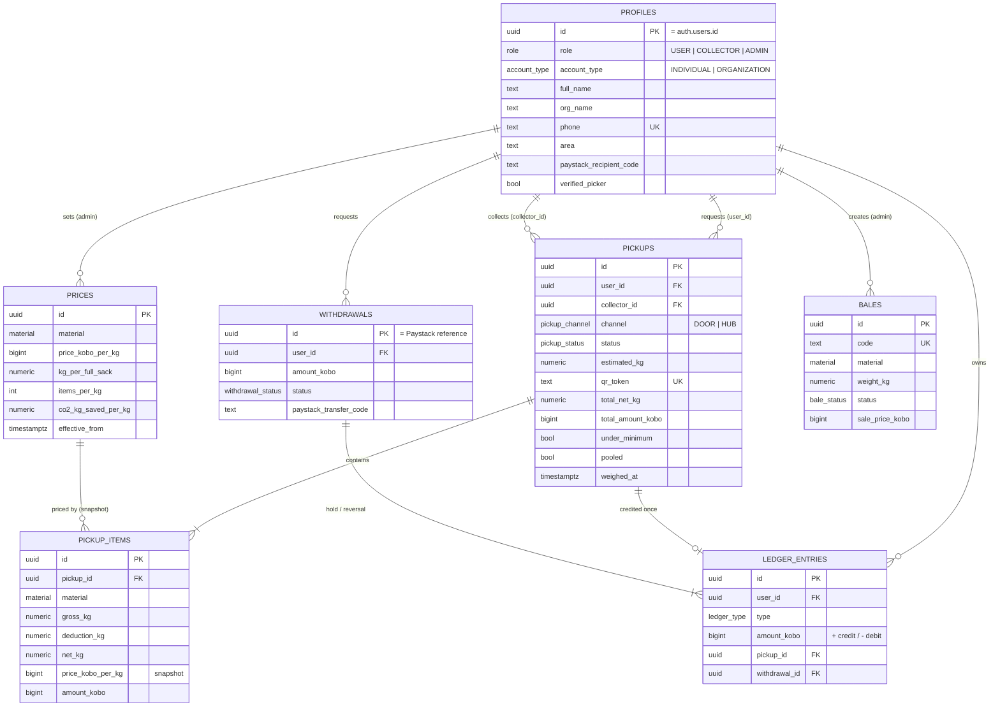

# Backend Schema
## PlastiCash by EcoCyclers

Postgres schema for Supabase, 7 tables. Alembic owns the `public` schema; Supabase's `auth` schema is left alone. The SQL below was checked on Postgres 16 with stub Supabase objects. It applies cleanly, the views return the right balance and stock, and the money constraints reject a second credit for the same pickup, a deduction larger than the gross weight, and a withdrawal under ₦1,000.

Conventions: money is `bigint` **kobo** (₦1 = 100 kobo; 1 point = ₦1), weights are `numeric(10,2)` kg, ids are UUIDs, times are `timestamptz`.

## 1. Entity relationship diagram



## 2. Enums

| Enum | Values |
|---|---|
| `role` | USER, COLLECTOR, ADMIN |
| `account_type` | INDIVIDUAL, ORGANIZATION |
| `material` | PET, PLASTIC, SACHET, CAN, TIN |
| `pickup_status` | REQUESTED, ASSIGNED, EN_ROUTE, AWAITING_CONFIRMATION, DISPUTED, COMPLETED, CANCELLED |
| `pickup_channel` | DOOR, HUB |
| `confirmed_via` | APP, OTP, AUTO, ADMIN |
| `ledger_type` | PICKUP_CREDIT, WITHDRAWAL_HOLD, WITHDRAWAL_REVERSAL, ADJUSTMENT |
| `withdrawal_status` | PENDING, PROCESSING, PAID, FAILED, REJECTED |
| `bale_status` | IN_STORE, PROCESSED, SOLD |

## 3. The constraints that protect money

| Guarantee | Enforced by |
|---|---|
| A pickup is credited once | `ledger_one_credit_per_pickup` (partial unique index) |
| One hold per withdrawal | `ledger_one_hold_per_withdrawal` |
| One refund per failed withdrawal | `ledger_one_reversal_per_withdrawal` |
| Credits positive, holds negative, adjustments need a note and an admin | `ledger_sign` check |
| Minimum withdrawal ₦1,000 | `withdrawals.amount_kobo >= 100000` |
| Deduction can't exceed gross weight; reason required | `deduction_le_gross`, `deduction_reason_required` |
| Completed pickups have an amount | `completed_has_amount` |
| Price changes don't alter old pickups | `pickup_items.price_kobo_per_kg` snapshot + insert-only `prices` |
| No overdraw on concurrent withdrawals | Application: `SELECT … FOR UPDATE` on the profile row before checking balance |

## 4. Full SQL

```sql
-- PlastiCash schema (public). Apply via Alembic (op.execute) or psql.
create extension if not exists pgcrypto;

-- ===== Enums =====
create type role as enum ('USER','COLLECTOR','ADMIN');
create type account_type as enum ('INDIVIDUAL','ORGANIZATION');
create type material as enum ('PET','PLASTIC','SACHET','CAN','TIN');
create type pickup_status as enum ('REQUESTED','ASSIGNED','EN_ROUTE','AWAITING_CONFIRMATION','DISPUTED','COMPLETED','CANCELLED');
create type pickup_channel as enum ('DOOR','HUB');
create type confirmed_via as enum ('APP','OTP','AUTO','ADMIN');
create type ledger_type as enum ('PICKUP_CREDIT','WITHDRAWAL_HOLD','WITHDRAWAL_REVERSAL','ADJUSTMENT');
create type withdrawal_status as enum ('PENDING','PROCESSING','PAID','FAILED','REJECTED');
create type bale_status as enum ('IN_STORE','PROCESSED','SOLD');

-- ===== 1. profiles =====
create table profiles (
  id                      uuid primary key,              -- = auth.users.id
  role                    role not null default 'USER',
  account_type            account_type,
  full_name               text not null,
  org_name                text,
  org_type                text,
  cac_number              text,
  phone                   text not null unique,
  email                   text not null,
  address                 text,
  area                    text,
  bank_name               text,
  bank_code               text,
  account_number          text,
  account_name            text,
  paystack_recipient_code text,
  verified_picker         boolean not null default false,
  is_active               boolean not null default true,
  created_at              timestamptz not null default now(),
  constraint user_needs_account_type check (role <> 'USER' or account_type is not null),
  constraint org_needs_name check (account_type is distinct from 'ORGANIZATION' or org_name is not null)
);

-- ===== 2. prices (versioned, insert-only) =====
create table prices (
  id                  uuid primary key default gen_random_uuid(),
  material            material not null,
  price_kobo_per_kg   bigint not null check (price_kobo_per_kg >= 0),
  kg_per_full_sack    numeric(6,2) not null check (kg_per_full_sack > 0),
  items_per_kg        integer check (items_per_kg > 0),
  co2_kg_saved_per_kg numeric(6,3) not null default 0 check (co2_kg_saved_per_kg >= 0),
  effective_from      timestamptz not null default now(),
  set_by              uuid references profiles(id),
  created_at          timestamptz not null default now()
);
create index prices_material_effective_idx on prices (material, effective_from desc);

-- ===== 3. pickups =====
create table pickups (
  id                    uuid primary key default gen_random_uuid(),
  user_id               uuid not null references profiles(id),
  collector_id          uuid references profiles(id),
  channel               pickup_channel not null default 'DOOR',
  status                pickup_status not null default 'REQUESTED',
  area                  text,
  address               text,
  lat                   numeric(9,6),
  lng                   numeric(9,6),
  preferred_date        date,
  preferred_window      text check (preferred_window in ('MORNING','AFTERNOON')),
  scheduled_date        date,
  pooled                boolean not null default false,
  estimate_sacks        numeric(5,1),
  estimate_note         text,
  estimated_kg          numeric(10,2),
  request_photo_url     text,
  qr_token              text not null unique default encode(gen_random_bytes(16), 'hex'),
  qr_scanned_at         timestamptz,
  collector_lat         numeric(9,6),
  collector_lng         numeric(9,6),
  collector_location_at timestamptz,
  weighed_at            timestamptz,
  weigh_photo_url       text,
  total_net_kg          numeric(10,2),
  total_amount_kobo     bigint check (total_amount_kobo >= 0),
  under_minimum         boolean not null default false,
  otp_hash              text,
  otp_expires_at        timestamptz,
  otp_attempts          integer not null default 0,
  otp_resends           integer not null default 0,
  reminders_sent        integer not null default 0 check (reminders_sent between 0 and 3),
  last_reminder_at      timestamptz,
  confirmed_at          timestamptz,
  confirmed_via         confirmed_via,
  dispute_photo_url     text,
  dispute_claimed_kg    numeric(10,2),
  dispute_reason        text,
  disputed_at           timestamptz,
  resolved_kg           numeric(10,2),
  resolved_by           uuid references profiles(id),
  resolution_note       text,
  cancelled_reason      text,
  created_at            timestamptz not null default now(),
  updated_at            timestamptz not null default now(),
  constraint completed_has_amount check (status <> 'COMPLETED' or total_amount_kobo is not null),
  constraint assigned_has_collector check (status in ('REQUESTED','CANCELLED') or collector_id is not null)
);
create index pickups_status_idx         on pickups (status);
create index pickups_area_status_idx    on pickups (area, status);
create index pickups_collector_idx      on pickups (collector_id, status);
create index pickups_user_created_idx   on pickups (user_id, created_at desc);
create index pickups_awaiting_weighed_idx on pickups (weighed_at) where status = 'AWAITING_CONFIRMATION';

-- ===== 4. pickup_items =====
create table pickup_items (
  id                uuid primary key default gen_random_uuid(),
  pickup_id         uuid not null references pickups(id) on delete cascade,
  material          material not null,
  gross_kg          numeric(10,2) not null check (gross_kg >= 0 and gross_kg <= 5000),
  deduction_kg      numeric(10,2) not null default 0 check (deduction_kg >= 0),
  deduction_reason  text,
  net_kg            numeric(10,2) not null check (net_kg >= 0),
  price_kobo_per_kg bigint not null check (price_kobo_per_kg >= 0),
  price_id          uuid not null references prices(id),
  amount_kobo       bigint not null check (amount_kobo >= 0),
  unique (pickup_id, material),
  constraint deduction_le_gross check (deduction_kg <= gross_kg),
  constraint deduction_reason_required check (deduction_kg = 0 or deduction_reason is not null)
);

-- ===== 5. ledger_entries (insert-only) =====
create table ledger_entries (
  id            uuid primary key default gen_random_uuid(),
  user_id       uuid not null references profiles(id),
  type          ledger_type not null,
  amount_kobo   bigint not null,
  pickup_id     uuid references pickups(id),
  withdrawal_id uuid,                                   -- FK added after withdrawals
  note          text,
  created_by    uuid references profiles(id),
  created_at    timestamptz not null default now(),
  constraint ledger_sign check (
    (type = 'PICKUP_CREDIT'       and amount_kobo > 0 and pickup_id is not null) or
    (type = 'WITHDRAWAL_HOLD'     and amount_kobo < 0 and withdrawal_id is not null) or
    (type = 'WITHDRAWAL_REVERSAL' and amount_kobo > 0 and withdrawal_id is not null) or
    (type = 'ADJUSTMENT'          and amount_kobo <> 0 and note is not null and created_by is not null)
  )
);
create unique index ledger_one_credit_per_pickup     on ledger_entries (pickup_id)     where type = 'PICKUP_CREDIT';
create unique index ledger_one_hold_per_withdrawal   on ledger_entries (withdrawal_id) where type = 'WITHDRAWAL_HOLD';
create unique index ledger_one_reversal_per_withdrawal on ledger_entries (withdrawal_id) where type = 'WITHDRAWAL_REVERSAL';
create index ledger_user_created_idx on ledger_entries (user_id, created_at desc);

-- ===== 6. withdrawals =====
create table withdrawals (
  id                      uuid primary key default gen_random_uuid(),  -- = Paystack transfer reference
  user_id                 uuid not null references profiles(id),
  amount_kobo             bigint not null check (amount_kobo >= 100000), -- ₦1,000 minimum
  status                  withdrawal_status not null default 'PENDING',
  bank_name               text not null,
  account_number          text not null,
  account_name            text not null,
  paystack_recipient_code text not null,
  paystack_transfer_code  text,
  failure_reason          text,
  reviewed_by             uuid references profiles(id),
  reviewed_at             timestamptz,
  paid_at                 timestamptz,
  created_at              timestamptz not null default now(),
  updated_at              timestamptz not null default now()
);
create index withdrawals_status_idx on withdrawals (status, created_at);
create index withdrawals_user_idx   on withdrawals (user_id, created_at desc);
alter table ledger_entries add constraint ledger_withdrawal_fk foreign key (withdrawal_id) references withdrawals(id);

-- ===== 7. bales =====
create table bales (
  id              uuid primary key default gen_random_uuid(),
  code            text not null unique,                -- e.g. PET-2026-0042
  material        material not null,
  weight_kg       numeric(10,2) not null check (weight_kg > 0),
  status          bale_status not null default 'IN_STORE',
  buyer           text,
  sale_price_kobo bigint check (sale_price_kobo >= 0),
  created_by      uuid not null references profiles(id),
  created_at      timestamptz not null default now(),
  processed_at    timestamptz,
  sold_at         timestamptz,
  constraint sold_has_buyer check (status <> 'SOLD' or (buyer is not null and sale_price_kobo is not null))
);
create index bales_material_status_idx on bales (material, status);

-- ===== Helper views (read-only) =====
create view wallet_balances with (security_invoker = true) as
  select p.id as user_id, coalesce(sum(l.amount_kobo), 0)::bigint as balance_kobo
  from profiles p left join ledger_entries l on l.user_id = p.id
  group by p.id;

create view current_prices with (security_invoker = true) as
  select distinct on (material) *
  from prices
  where effective_from <= now()
  order by material, effective_from desc;

create view raw_stock with (security_invoker = true) as
  select m.material,
         coalesce(i.kg_in, 0)  as kg_in,
         coalesce(b.kg_baled, 0) as kg_baled,
         coalesce(i.kg_in, 0) - coalesce(b.kg_baled, 0) as kg_in_store
  from unnest(enum_range(null::material)) as m(material)
  left join (select pi.material, sum(pi.net_kg) kg_in
             from pickup_items pi join pickups pk on pk.id = pi.pickup_id
             where pk.status = 'COMPLETED' group by pi.material) i on i.material = m.material
  left join (select material, sum(weight_kg) kg_baled from bales group by material) b on b.material = m.material;

-- Views are for FastAPI only. security_invoker makes them respect RLS; also hide them from the browser roles.
revoke all on wallet_balances, current_prices, raw_stock from anon, authenticated;

-- ===== Row Level Security =====
-- FastAPI connects as the owner and is not limited by RLS. The browser only reads pickups via Realtime.
alter table profiles       enable row level security;
alter table prices         enable row level security;
alter table pickups        enable row level security;
alter table pickup_items   enable row level security;
alter table ledger_entries enable row level security;
alter table withdrawals    enable row level security;
alter table bales          enable row level security;

create policy "own or assigned pickups readable" on pickups
  for select to authenticated
  using (user_id = auth.uid() or collector_id = auth.uid());

alter publication supabase_realtime add table pickups;
```

## 5. Notes for Alembic

- Generate the tables from SQLModel models, then put the partial unique indexes, check constraints, views, RLS and the Realtime publication in the migration with `op.execute(...)` (autogenerate doesn't produce them).
- Exclude the `auth`, `storage` and `realtime` schemas in `env.py` (`include_schemas=False`, `include_object` filter), so autogenerate never tries to drop Supabase tables.
- `profiles.id` has no foreign key to `auth.users` in the migration (cross-schema). Optionally add it by hand: `references auth.users(id) on delete cascade`.
- Tests run this same migration on a local Postgres. Create stub `auth.uid()`, the `anon`/`authenticated` roles and the `supabase_realtime` publication first (see `tests/conftest.py`).

## 6. Common queries

```sql
-- Balance
select balance_kobo from wallet_balances where user_id = :uid;

-- Withdrawal request (inside one transaction)
select id from profiles where id = :uid for update;
select coalesce(sum(amount_kobo),0) from ledger_entries where user_id = :uid;  -- check >= amount
insert into withdrawals (...) values (...) returning id;
insert into ledger_entries (user_id, type, amount_kobo, withdrawal_id) values (:uid, 'WITHDRAWAL_HOLD', -:amount, :wid);

-- Pickups due for reminder / auto-confirm
select id, weighed_at, reminders_sent from pickups
where status = 'AWAITING_CONFIRMATION' and weighed_at < now() - interval '2 hours'
for update skip locked;

-- Area pooling totals for the admin board
select area, count(*), sum(estimated_kg) from pickups
where status = 'REQUESTED' group by area order by sum(estimated_kg) desc;

-- Raw stock
select * from raw_stock;
```
