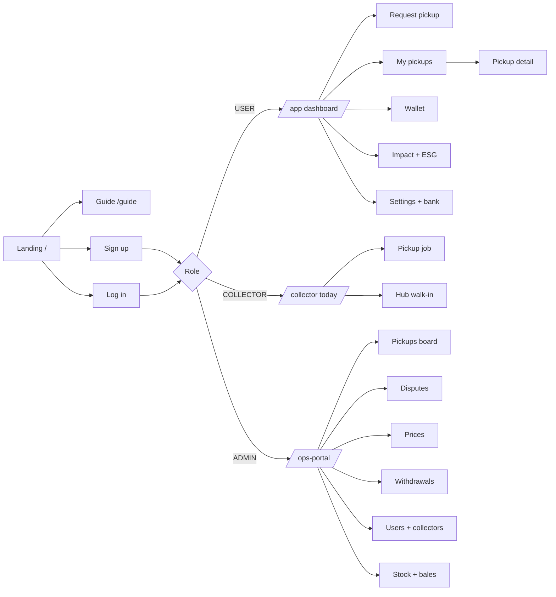
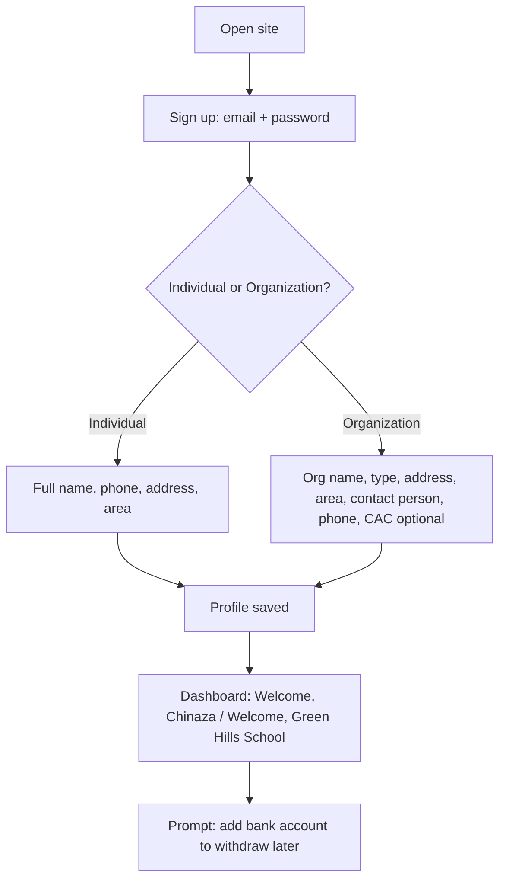
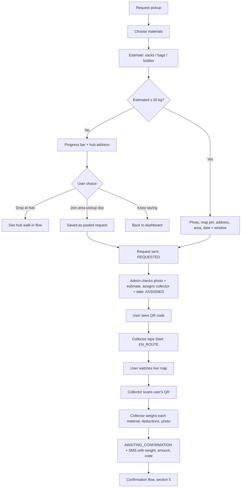
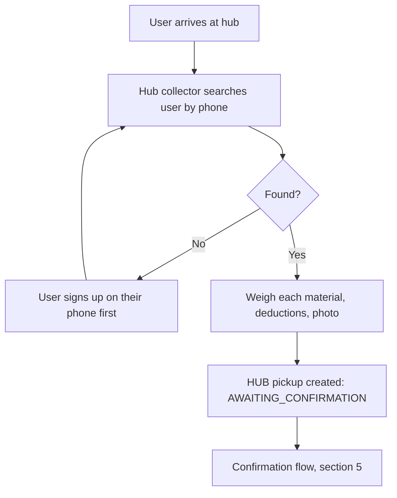
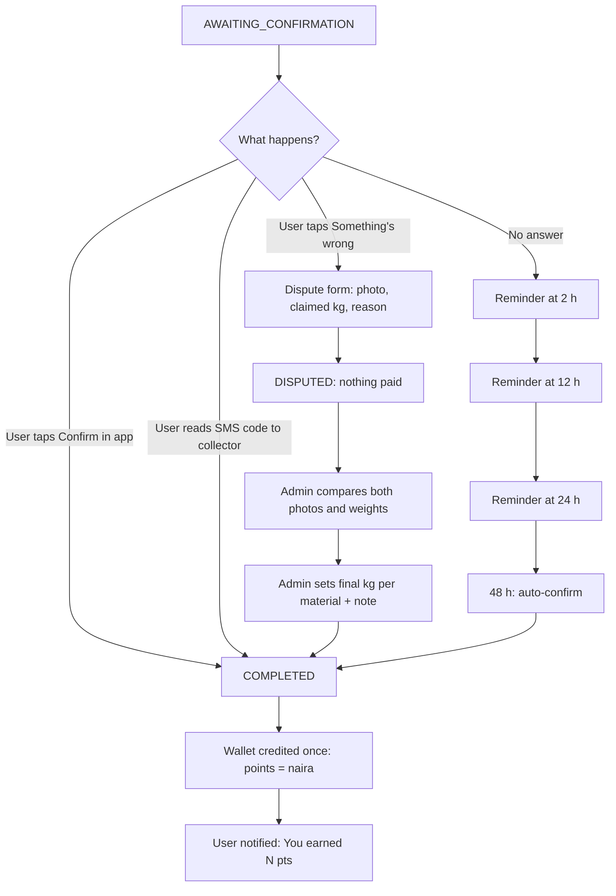
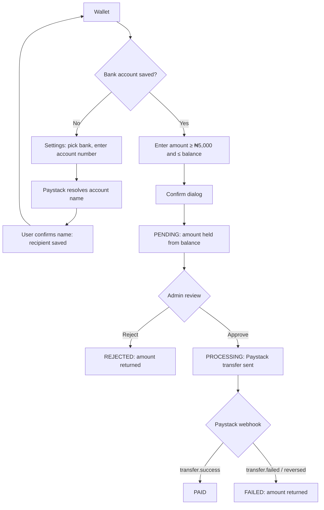
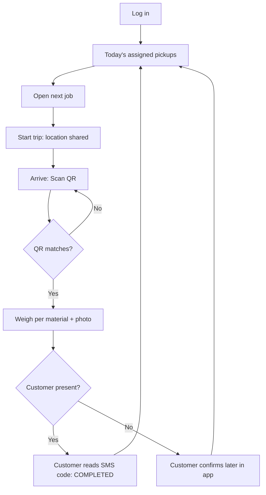
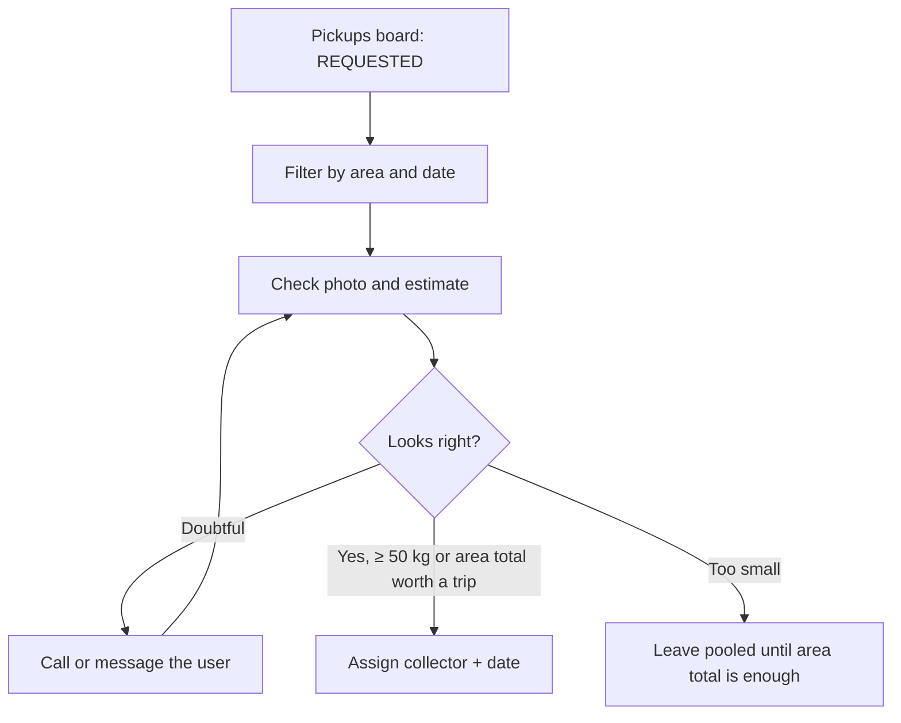
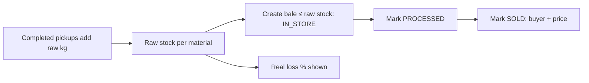

# App Flow
## PlastiCash by EcoCyclers

How each person moves through the app, step by step. Diagrams use Mermaid (they render on GitHub and in most Markdown viewers).

---

## 1. Navigation map

## 2. Sign-up and onboarding

Steps:
1. Sign up with email and password (Supabase).
2. Choose **Individual** or **Organization**; fill the matching fields.
3. Land on the dashboard with a personal greeting.
4. A card reminds them to add a bank account (needed only to withdraw).

## 3. Door pickup (main journey)

## 4. Hub walk-in

## 5. Confirmation, dispute and auto-confirm

After COMPLETED, a complaint goes to the admin, who can add an **adjustment** with a note. Nothing already recorded is edited.

## 6. Withdrawal

## 7. Collector's day

## 8. Admin flows

### Daily dispatch

### Prices
Add a new price version for a material (₦/kg, kg per sack, items per kg, CO₂ factor). It applies to all weighings from now on; earlier pickups keep their old price.

### Stock and bales

## 9. Notifications

| Event | User sees | Channel |
|---|---|---|
| Pickup assigned | "Collector assigned for {date}" | In-app (Realtime + toast) |
| Collector on the way | Live map | In-app |
| Weighed | Weight, amount, code | SMS + in-app |
| Reminder | "Please confirm your pickup" | SMS (2, 12, 24 h) |
| Paid | "You earned N pts" | In-app |
| Dispute resolved | Final weight + note | In-app |
| Withdrawal paid / failed | Status change | In-app |

## 10. Pickup status reference

| Status | Meaning | Next |
|---|---|---|
| REQUESTED | Waiting for admin | ASSIGNED, CANCELLED |
| ASSIGNED | Collector and date set | EN_ROUTE, CANCELLED |
| EN_ROUTE | Collector travelling | AWAITING_CONFIRMATION |
| AWAITING_CONFIRMATION | Weighed, waiting for user | COMPLETED, DISPUTED |
| DISPUTED | Admin reviewing | COMPLETED |
| COMPLETED | Paid | final |
| CANCELLED | Cancelled | final |
